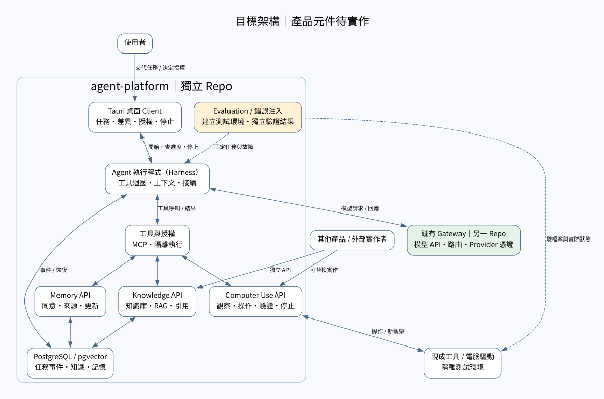

# 技術、目錄與對外邊界

此圖是目標架構，所有產品元件待實作。



## 邊界與技術

| 部分          | 責任                                | 技術與接法                                                             |
| ------------- | ----------------------------------- | ---------------------------------------------------------------------- |
| 桌面 Client   | 任務、差異、授權、停止、成果        | Tauri 2、React、TypeScript；原生選檔與快捷鍵                           |
| Agent Harness | 模型/工具迴圈、上下文、任務、恢復   | 先試接 Codex Rust app-server；Rig為組件替代候選，P01同題比較後只留一套 |
| 應用服務      | 身分、範圍、Task API、事件串流      | Rust 2024、Axum、Tokio、Serde、thiserror                               |
| 工具執行      | schema、授權、隔離、副作用收據      | Rust；官方rmcp候選；shell在容器，有限timeout與輸出                     |
| Knowledge     | 文件版本、ACL、檢索與引用           | SQLx、PostgreSQL全文、pgvector；免費本機embedding                      |
| Memory        | 經同意的偏好/事實、來源、更新與撤回 | Rust + SQLx；資料與知識庫分表分權限                                    |
| Computer Use  | 觀察/操作/驗證/停止                 | Rust adapter + 經實測的現成驅動；隔離Linux桌面                         |
| Evaluation    | 固定案例、環境驗證、版本比較        | Rust CLI；Toxiproxy測網路，假端點測語意，容器測重啟                    |
| Gateway       | 統一模型API，保管Provider憑證       | 既有獨立Rust repo；Agent不搬走其責任                                   |
| 可觀測性      | 串起一次任務的錯誤與延遲            | tracing + OpenTelemetry OTLP；低基數標籤、禁止內容/秘密                |

上述版本是技術大版本選擇；小版本及相容性由P01鎖定與編譯證明。伺服器與worker在Docker/Podman；Tauri為互動式桌面程式。初版同一後端程序與DB就足夠，但各API、資料表與授權分清，不預先做分散式系統。

## 預定目錄

下列是P01後逐步建立的路徑，本次不放空的假程式。

```text
apps/desktop/                  Tauri + React；使用者操作
apps/server/                   Axum入口與組裝
apps/eval/                     獨立Rust評測CLI
crates/agent/                  任務與Harness接法
crates/tools/                  授權、工具與MCP
crates/knowledge/              匯入、版本、RAG
crates/memory/                 長期記憶
crates/computer-use/           可替換的操作介面
crates/storage/                SQL與migration
contracts/                    API及事件schema
fixtures/                     合成測試資料與故障案例
scripts/                      gate、完整檢查、測試容器
infra/                        本機容器編排
Cargo.toml / Cargo.lock        單一workspace與Rust依賴鎖
package.json / package-lock.json 桌面工具鎖
```

不為每個trait開crate。共用型別先放有責任歸屬的模組；確有第三次重複才抽出。crate依賴不得循環，UI不直接依賴資料層。路由僅驗參數、呼叫服務、對應錯誤；SQL留storage；設定集中，模型名稱不散落程式。

## 給外部實作者的契約

P02固定Task啟動/查詢/事件/授權/取消契約；P05固定Knowledge匯入/查詢；P06固定Memory寫入/查詢/更新/撤回；P07固定Computer Use能力/觀察/操作/驗證/取消。HTTP、MCP或程序介面依現成能力選最小接法，不同時為每個模組實作三種協定。

每個契約都含版本、request ID、授權scope、deadline、取消語意、型別化錯誤與結果未知狀態。外部服務必須自己再驗身分與scope，不能信任任意Client傳owner。第二個CLI Client必須能獨立使用，才算可交接；共用Rust內部型別不算跨語言契約。

Agent收到文件後可呼叫知識檢索，工具得到結果後回傳Harness，Harness再決定下一步；Gateway只接模型請求。Computer Use不擁有任務總控；Evaluation在旁建立環境及驗結果，不是產品模型自己評分。
